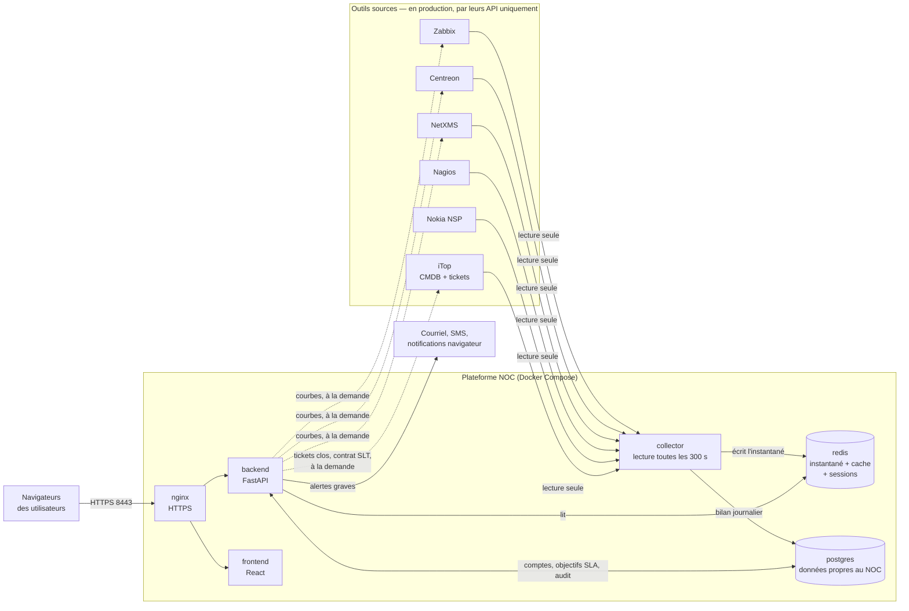
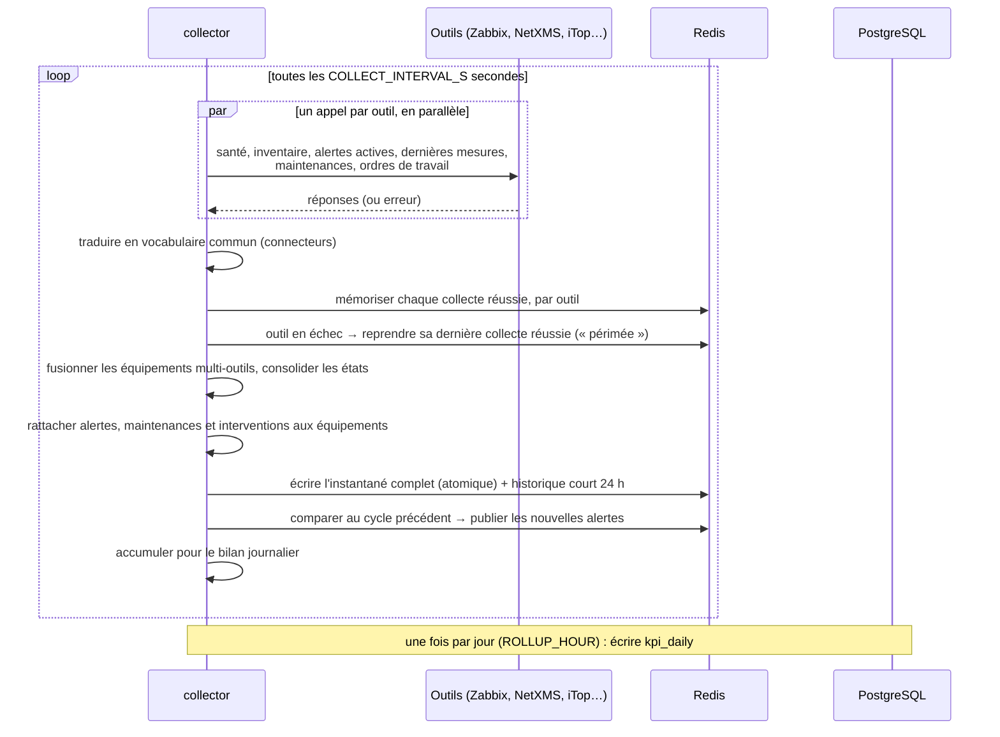
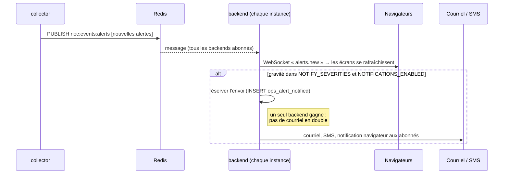

# 2. Architecture

> Ce chapitre décrit **comment** la plateforme est construite. Le **pourquoi**
> détaillé de chaque choix est dans [ARCHITECTURE.md](../ARCHITECTURE.md), à
> lire avant toute modification de fond.

## Vue d'ensemble

**Toutes les données de supervision viennent des API des outils.** Le NOC ne
crée, n'acquitte, n'affecte ni ne résout aucune alerte ni aucun incident :
ces gestes se font dans l'outil source ou dans iTop, et le NOC les relit.

En local, deux exports de production peuvent remplacer une API pour
visualiser des données réelles (base NetXMS restaurée, journal Centreon) :
ils entrent par un connecteur différent, choisi par la forme de l'URL, et
produisent les mêmes équipements et alertes. Ils n'existent pas en
production. Voir [chapitre 4](04-sources-de-donnees.md#les-façons-dalimenter-la-plateforme-en-local).

## Les conteneurs

Tout tourne dans Docker Compose (`docker-compose.yml`). Les services du **cœur**
démarrent avec `docker compose up` ; les autres sont dans des **profils**
lancés à la demande.

| Service | Rôle | Profil | Données persistées |
|---|---|---|---|
| `collector` | Lit les outils sources, publie l'instantané dans Redis, écrit le bilan journalier | cœur | — |
| `redis` | Instantané du parc et des alertes, dernières collectes valides par outil, cache des courbes et de l'historique iTop, sessions de connexion | cœur | volume `redisdata` |
| `postgres` | Base du NOC : comptes, objectifs SLA, journal d'audit, notifications, agrégats journaliers | cœur | volume `pgdata` ⚠️ |
| `backend` | API REST et WebSocket, notifications, rapports | cœur | volume `reports` |
| `frontend` | Interface web (fichiers statiques servis par nginx interne) | cœur | — |
| `nginx` | Passerelle HTTPS : `/api` et `/ws` vers le backend, le reste vers le frontend | cœur | — |
| `netxms-db` | **Local** : base NetXMS restaurée depuis le dump de production | `netxms` | volume `netxms_pgdata` |
| `mailpit` | Faux serveur SMTP de test | `mail` | — |
| `zabbix-*` | Zabbix 7.0.23 de laboratoire (base, serveur, web, agent) | `zabbix`, `tools` | volume `zabbix_pgdata` |
| `itop`, `itop-db` | iTop 3.2.3 de laboratoire | `itop`, `tools` | volumes `itop_*` |
| `centreon`, `centreon-db` | Centreon 22.10.7 de laboratoire | `centreon`, `tools` | volumes `centreon_*` |
| `nagios` | Nagios Core 4.5.12 de laboratoire | `nagios`, `tools` | — |
| `provision` | Tâche ponctuelle : déclare les machines à superviser dans les outils de laboratoire | `provision` | — |

`docker-compose.dumps.yml`, à ajouter **en local seulement**, donne au
collecteur un accès en lecture seule au dossier `database/` (export du
journal Centreon). La configuration de base n'en dépend pas.

Le volume `pgdata` est **le seul dont la perte est grave** : il contient ce
qu'aucun outil ne saurait redonner (comptes, objectifs SLA, journal d'audit,
bilans journaliers passés).

## Le principe fondateur : qui possède quelle donnée

Toute l'architecture découle d'une règle : **on ne persiste que ce qu'aucun
outil source ne saurait nous redonner.**

| Famille | Exemples | Propriétaire | Où elle vit dans le NOC |
|---|---|---|---|
| **État instantané** | équipements, leur état, alertes actives, tickets iTop ouverts, maintenances et ordres de travail, dernières mesures, santé des outils | l'outil source | **Redis**, réécrit en entier à chaque cycle, expire au bout de 3 cycles |
| **Historique** | courbes de mesures, tickets iTop clos, engagements contractuels (SLT) | l'outil source | **nulle part** : demandé à l'outil au moment où on l'affiche, puis mis en cache |
| **Agrégats** | bilan journalier par site (disponibilité, pannes, alertes) | le NOC, calculé sur ce qu'il a observé | **PostgreSQL** (`kpi_daily`) |
| **Journal historique** | périodes d'état de chaque équipement et de chaque lien surveillé, ouverture et fermeture de chaque alerte — **pas les mesures** | le NOC, d'après ce qu'il a observé | **PostgreSQL** (`hist_state`, `hist_alert`) |
| **Données propres au NOC** | comptes, objectifs SLA, journal d'audit, abonnements et journal des notifications | **le NOC** | **PostgreSQL** |

Conséquences concrètes :

- La base PostgreSQL est **petite** (quelques Mo) : pas de métriques, pas
  d'historique d'alertes, aucune copie d'équipement ou de ticket.
- Un équipement retiré d'un outil **disparaît** du NOC au cycle suivant.
- Si la collecte s'arrête, les écrans affichent **« collecte interrompue »**
  plutôt qu'un parc faussement calme.
- La version précédente du projet recopiait tout dans un entrepôt
  (TimescaleDB, tables `dim_*`/`fact_*`) ; elle a été abandonnée pour cette
  raison.

## Les flux, un par un

### Flux 1 — Le cycle de collecte (toutes les 300 s)

Points clés (code : `collector/cycle.py`, `collector/merge.py`) :

- **Un outil en panne n'empêche pas les autres** : chacun est interrogé dans sa
  propre tâche, derrière un délai de garde et un disjoncteur.
- **Le cycle est borné dans le temps** (`COLLECT_CYCLE_TIMEOUT_S`) : un outil
  qui ne répond pas est abandonné pour ce cycle.
- **Un outil injoignable garde sa dernière vue**, marquée périmée : ses
  équipements restent à l'écran avec leur dernier état connu, sans contredire
  les outils qui répondent. Si aucune source ni aucune collecte mémorisée ne
  fournit de données, l'instantané précédent est conservé au lieu de
  présenter un parc vide comme sain.
- **La fusion ne devine pas** : deux outils voient le même équipement
  seulement s'ils donnent le même nom technique **et** la même IP, de façon
  unique. Les cas ambigus restent séparés et sont exposés sur l'écran
  Intégrations, comme les équipements vus par un seul outil et les alertes
  qui ne trouvent pas leur équipement.
- **Au premier démarrage, rien n'est diffusé** : toutes les alertes seraient
  « nouvelles » et l'équipe recevrait des centaines de courriels.
- **Un seul collecteur** doit tourner. En lancer deux doublerait la charge sur
  la production sans rien accélérer.

### Flux 2 — L'affichage d'un écran

Le navigateur appelle l'API (`/api/overview`, `/api/alerts`, `/api/nodes`…).
Le backend lit **Redis uniquement** (`backend/app/services/live_service.py`) :
quelques microsecondes, quel que soit le nombre d'opérateurs connectés. Les
écrans se rafraîchissent toutes les 20 à 60 secondes, et le WebSocket les
réveille dès qu'une nouvelle alerte arrive.

Sur l'instantané, le backend applique à chaque requête :

- les **maintenances en cours** (changements iTop, maintenances Zabbix) :
  l'équipement passe « en maintenance », son état mesuré reste visible et ses
  alertes sont marquées (`node_service.py`, `alerts_service.py`) ;
- le **périmètre** demandé — région, province, site — avec la même règle sur
  tous les écrans (`geo_service.py`) ;
- les **agrégats** de l'écran : disponibilité, états, alertes par gravité,
  liens, couverture par outil (`metrics_service.py`, `kpi_service.py`).

### Flux 3 — Les incidents et les SLA (historique iTop à la demande)

Les tickets **ouverts** sont dans l'instantané. Les tickets **clos**, eux,
restent chez iTop : pour les SLA, les indicateurs d'incidents et le rapport
mensuel, le backend demande à iTop les tickets ouverts sur la période
(`fetch_incident_history`) et garde la réponse 5 minutes en cache
(`incident_service.py`). Les délais de prise en charge et de résolution sont
comparés aux objectifs du NOC (`ops_sla_target`) ; les engagements
contractuels déclarés dans iTop (SLT) sont lus de la même façon et affichés à
côté. Si iTop ne répond pas, l'écran le dit au lieu d'afficher des taux à
zéro.

### Flux 4 — Une nouvelle alerte grave

Détails : [chapitre 6](06-alertes-et-notifications.md).

### Flux 5 — Une courbe (historique à la demande)

Quand un utilisateur ouvre la courbe de latence d'un équipement, le backend
**interroge l'outil source** (`history.get`/`trend.get` chez Zabbix, par
exemple) et met la réponse en cache dans Redis
(`backend/app/services/history_service.py`). Les utilisateurs suivants qui
ouvrent la même courbe sont servis par le cache. Si l'outil est injoignable,
l'écran le dit explicitement au lieu d'afficher une courbe vide.

### Flux 6 — Le journal historique

À chaque cycle, après la publication de l'instantané, le collecteur met à
jour le journal (`collector/history.py`) : il ouvre une période quand l'état
d'un équipement ou d'un lien change, la clôt au changement suivant, et fait
de même pour chaque alerte. Les tables ne grandissent qu'aux changements
(quelques Mo par mois). Trois règles le rendent fiable :

- un outil qui ne répond pas **ne clôt rien** : seuls les outils lus à ce
  cycle peuvent faire disparaître un équipement ou une alerte ;
- au-delà de trois cycles sans observation (collecteur arrêté, outil muet),
  la période s'arrête à sa dernière observation : le trou est publié comme
  **non observé**, jamais compté disponible ;
- une erreur d'écriture est journalisée sans interrompre le cycle ; le cycle
  suivant reprend là où il s'était arrêté.

Le backend le lit (`availability_service.py`, routes `/api/history/*`) pour
la disponibilité sur la durée d'un équipement ou d'un lien, ses pannes, le
MTTR technique et les classements. Il sert aussi à **recalculer un bilan
journalier manquant** (flux 7).

### Flux 7 — Le bilan journalier

Le collecteur accumule, cycle après cycle, le nombre d'équipements, de pannes
et d'alertes par site. Une fois par jour, il écrit **une ligne par jour et par
site** dans la table `kpi_daily` (`collector/rollup.py`). Ce sont ces agrégats
qui permettent au tableau Direction et au rapport mensuel d'afficher des
tendances sur plusieurs mois sans interroger les outils sur toute la période.
Les compteurs du jour en cours sont **sauvegardés dans Redis à chaque
cycle** (`noc:rollup:pending`) et repris au redémarrage du collecteur : un
redémarrage en cours de journée ne perd plus rien. Un bilan dont l'écriture
échoue (base indisponible) reste en attente et est **réessayé toutes les
`ROLLUP_RETRY_S` secondes** (15 min) jusqu'à être écrit ; un collecteur
arrêté à l'heure du bilan l'écrit à son redémarrage. En dernier recours, un
jour resté sans bilan est **recalculé depuis le journal historique** : chaque
nuit pour les 7 derniers jours, ou à la main (`python -m collector.history`,
chapitre 9).

## Le contrat Redis

Le collecteur écrit, le backend lit. Les noms de clés sont définis **à un seul
endroit** : `collector/state.py`, que les deux services importent.

| Clé | Contenu | Durée de vie |
|---|---|---|
| `noc:live:nodes` | tous les équipements, fusionnés | 3 × `COLLECT_INTERVAL_S` |
| `noc:live:alerts` | alertes actives et tickets iTop ouverts | 3 × `COLLECT_INTERVAL_S` |
| `noc:live:meta` | horodatage et statistiques du dernier cycle, rapport de fusion, alertes orphelines | 3 × `COLLECT_INTERVAL_S` |
| `noc:live:latest` | dernières mesures par équipement | 3 × `COLLECT_INTERVAL_S` |
| `noc:live:maintenance`, `noc:live:work_orders` | maintenances planifiées, ordres de travail iTop | 3 × `COLLECT_INTERVAL_S` |
| `noc:live:trend` | historique court : un point par cycle (disponibilité, pannes, alertes) | 24 h glissantes |
| `noc:live:alerts:seen` | clés des alertes du cycle précédent (détection des nouveautés) | sans expiration |
| `noc:live:alerts:seen_since` | marqueur « le NOC a déjà tourné » : seul un vrai premier démarrage ne notifie rien | sans expiration |
| `noc:rollup:pending` | compteurs du bilan journalier en cours ou non encore écrit | sans expiration |
| `noc:tool:<outil>` | santé d'un outil : joignable, latence, version, dernière erreur | 3 × `COLLECT_INTERVAL_S` |
| `noc:source:<outil>:<flux>` | dernière collecte réussie d'un outil (équipements, alertes, maintenances…) | sans expiration |
| `noc:hist:<empreinte>` | courbe, historique iTop ou contrat SLT mis en cache | selon la donnée (5 min pour iTop) |
| `noc:events:alerts` | canal de publication des nouvelles alertes | — |
| `refresh:*`, `refresh_user:*` | sessions de connexion (jetons de rafraîchissement) | 7 jours |
| `auth_failures:*`, `auth_locked:*` | verrouillage après échecs de connexion (mot de passe par compte et par adresse, PIN par adresse) | 15 min |
| `access_revoked_before:*` | instant avant lequel les jetons d'accès d'un compte sont refusés | 31 min |

Une clé d'instantané **absente** signifie « la collecte ne tourne plus » ; une
liste **vide** signifie « la collecte tourne et ne trouve rien ». Le code
distingue soigneusement les deux.

## Principes à respecter en faisant évoluer le projet

1. **Ne pas recopier les données des outils sources.** Si un besoin semble
   l'exiger, se demander d'abord si l'outil ne peut pas le fournir à la
   demande, ou si un agrégat journalier suffit.
2. **La charge sur la production est constante et connue d'avance** : une
   série de requêtes par outil par cycle, quel que soit le nombre
   d'utilisateurs. Ne jamais ajouter d'appel vers un outil déclenché par un
   rafraîchissement automatique d'écran.
3. **Lecture seule envers la production.** Les connecteurs ne modifient rien
   chez les outils, et le NOC n'a pas de circuit de traitement parallèle :
   acquitter, affecter, résoudre se fait dans l'outil ou dans iTop.
4. **En production, uniquement les API.** Les exports (dump NetXMS, journal
   Centreon) servent à visualiser en local ; un connecteur qui n'existe que
   pour eux ne doit jamais être requis en production.
5. **Un outil s'active par son URL.** Pas de liste d'outils à tenir ailleurs.
6. **Un seul collecteur**, autant de backends que nécessaire.
7. **Dire plutôt que deviner** : une donnée absente s'affiche « — » ou « non
   collectée », jamais inventée. Un site inconnu reste inconnu.
